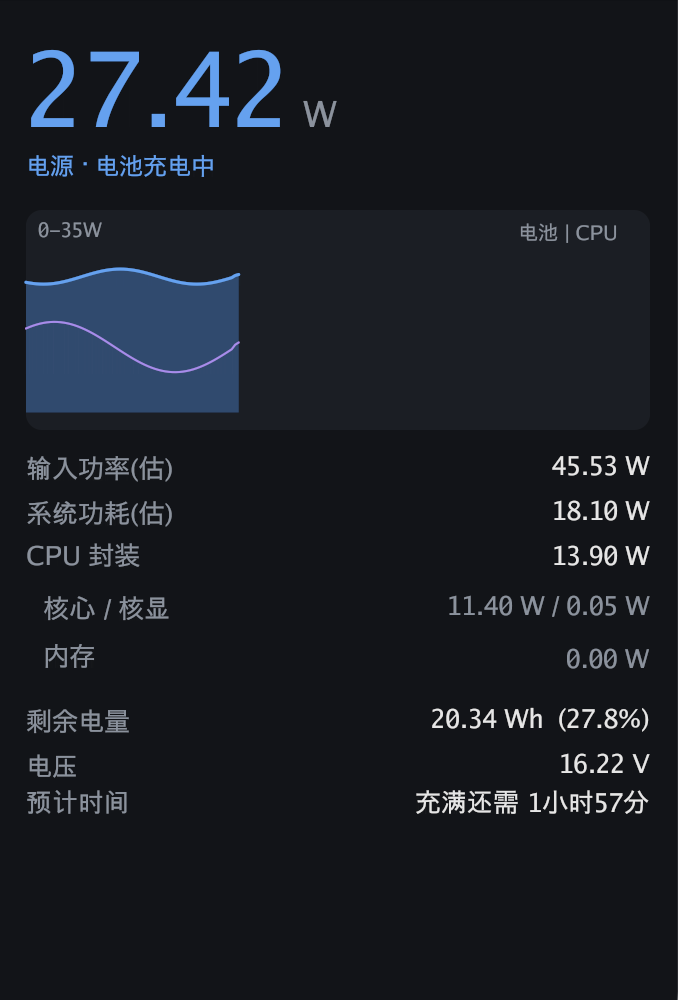
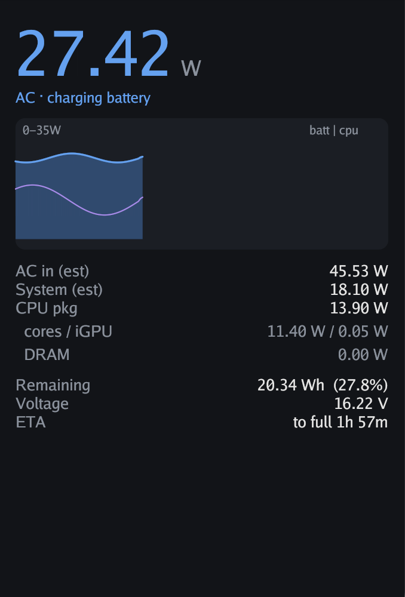

# batterymon

Windows 笔记本 / 台式机实时功率监视器 —— 电池充放电功率、CPU 功耗（RAPL)、实时功率曲线、桌面 GUI + 命令行、中英双语界面。

[English README](README.md)

| 笔记本(充电中) | 界面(英文) |
|---|---|
|  |  |

## 特性

- **电池功率(笔记本)** —— 充/放电瓦数，直接来自电池 EC 芯片（WMI `root\wmi BatteryStatus`)，不是估算值
- **CPU 功耗(任意 Intel 机器)** —— 封装 / 核心 / 核显 / 内存功耗，走 `\Energy Meter(RAPL_*)\Power` 性能计数器，**免驱动、免管理员**
- **系统功耗 & 适配器输入功率** —— 用电池时：精确（EC 放电率 = 整机功耗）；充电时：估算（充电 + 系统），杂项功耗（屏幕/SSD/Wi-Fi）在放电时段自动校准
- **台式机模式** —— 检测不到电池自动切换为纯 CPU 功耗视图
- **实时曲线** —— 最近 3 分钟电池 / CPU 功率滚动曲线
- **中英双语** —— 跟随 Windows 显示语言，`-lang zh|en` 可强制
- **CLI 模式** —— 终端里看同样的数据，`-once` 适合接脚本/告警
- **单文件免安装** —— ~9 MB 单 exe，无依赖、无需管理员；GUI 用纯 Go([Gio](https://gioui.org)) 编写，可从 macOS/Linux 交叉编译

## 下载 / 构建

预编译二进制见 [Releases](../../releases) 页面。自行构建（Go ≥ 1.23，任意系统交叉编译；WMI/PDH 部分仅 Windows 可用）:

```sh
git clone https://github.com/985860612/batterymon.git
cd batterymon

# CLI
GOOS=windows GOARCH=amd64 go build -ldflags="-s -w" -o batterymon.exe .

# GUI —— 先嵌入图标/版本资源 (需要 goversioninfo)
go install github.com/josephspurrier/goversioninfo/cmd/goversioninfo@latest
cd gui && goversioninfo -o rsrc_windows_amd64.syso versioninfo.json && cd ..
GOOS=windows GOARCH=amd64 go build -ldflags="-s -w -H windowsgui" -o batterymon-gui.exe ./gui
```

## 使用

```sh
# GUI: 双击 batterymon-gui.exe

# CLI: 实时监控, 默认 2 秒刷新
batterymon.exe

# 自定义间隔 / 单条输出(接脚本) / 强制语言
batterymon.exe -i 5s
batterymon.exe -once
batterymon.exe -once -lang en
```

CLI 输出示例(笔记本, 充电中):

```
状态      : 电源 / 充电中
充电功率  : 27.08 W  (充入电池)
CPU 封装  : 4.06 W  (核心 3.42 / 核显 0.01 / 内存 0.00)
系统功耗(估): 8.06 W
输入功率(估): 35.14 W  (适配器输出)
剩余电量  : 32.52 Wh  (44.4% / 满充 73.2 Wh)
电压      : 16.55 V
预计时间  : 充满还需 1小时30分
```

## 原理

| 指标 | 来源 | 精度 |
|---|---|---|
| 充/放电功率 | 电池 EC(WMI `root\wmi BatteryStatus`) | 精确；放电时=整机功耗 |
| CPU 功耗 | `\Energy Meter(RAPL_Package0_PKG/PP0/PP1/DRAM)\Power` 性能计数器(PDH API) | 精确(Intel RAPL) |
| 系统功耗 | 放电：EC 放电率(精确)；充电：RAPL + 杂项(估算) | 混合 |
| 适配器输入 | 多数笔记本固件不暴露 → 充电 + 系统估算 | 估算 |

注意事项：

- `\Power Meter(*)\Power` 计数器在部分机器上存在但恒为 0（固件未实现）——那才是真正的适配器输入直读，可惜通常拿不到
- 速率型 PDH 计数器需要两次采样，启动后第一帧读数跳过
- RAPL 是 Intel 特性（Sandy Bridge 起）;AMD 机器目前只有电池数据 —— 欢迎 PR

## 项目结构

```
main.go            CLI (windows)
gui/main.go        GUI 程序 (windows)
gui/ui/            纯界面层, 数据驱动, 跨平台
gui/preview/       假数据预览, 在 macOS/Linux 上迭代界面
internal/power/    电池 EC (WMI) + RAPL (PDH) + 杂项自校准
internal/i18n/     中英探测与文案
tools/icon/        程序化图标生成器 (矢量画电池+闪电)
```

## 许可证

[MIT](LICENSE)
